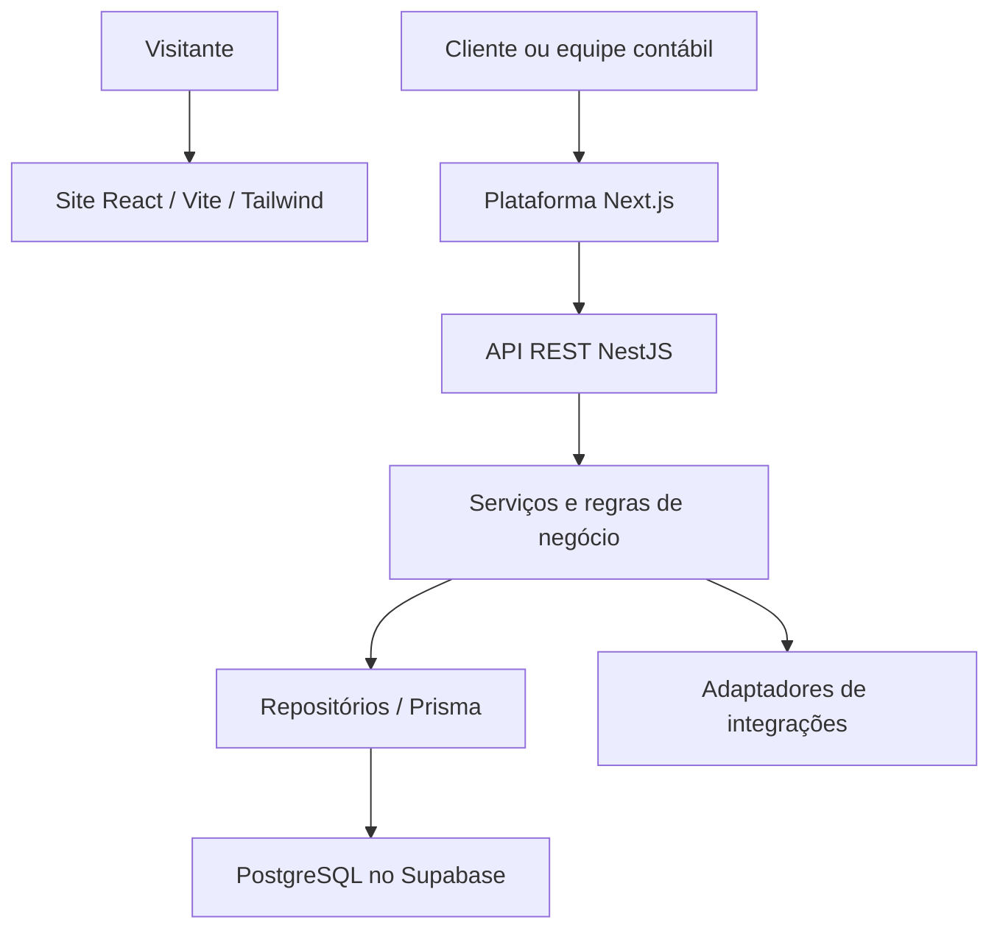

# Fisconta Online — Documento do sistema

[Voltar ao perfil](../README.md) · [Site público](https://www.fiscontaonline.com.br/)

## Contexto e objetivo

A presença digital apresenta serviços contábeis e canais de contato. A plataforma de atendimento organiza a interação entre empresas e equipe contábil, com acesso autenticado, empresas e atendimentos. São duas superfícies distintas; o site público não comprova que todas as funções da plataforma estejam disponíveis em produção.

## Escopo e evidências

O manifesto do site confirma React, TypeScript, Vite e Tailwind CSS. A documentação da plataforma descreve frontend Next.js, backend NestJS em monólito modular, Prisma e PostgreSQL no Supabase. O autor informa modularização, SOLID, POO, alta coesão e baixo acoplamento. Esta apresentação reúne esses componentes sem publicar endereços de repositórios empresariais ou dados internos.

## Arquitetura

O diagrama separa site e plataforma; não afirma integração automática entre eles. Na plataforma, o frontend chama a API, enquanto o backend centraliza validação, autenticação, autorização e acesso aos dados. A documentação descreve módulos para empresas, vínculos de usuários, atendimentos e mensagens, documentos e notificações. A disponibilidade de cada fluxo depende da configuração e da implantação.

A estrutura separa apresentação, casos de uso, regras e persistência. Serviços e repositórios com responsabilidades delimitadas favorecem alta coesão. Contratos e injeção de dependências reduzem o acoplamento com ORM e integrações. SOLID e POO são diretrizes de implementação informadas pelo autor; não significam criar classes para cada função ou adicionar camadas sem necessidade.

## Contexto da stack e alternativas

| Escolha | Contexto da decisão | Contrapartida |
|---|---|---|
| React + Vite | Site institucional com componentes reutilizáveis e build estático | Conteúdo e indexação exigem validação; um site estático mais simples pode custar menos |
| Tailwind CSS | Padronização de estilo e ajustes por componentes | Exige disciplina para manter consistência e legibilidade |
| Next.js | Interface da plataforma e organização de rotas | Runtime e estratégia de renderização aumentam opções operacionais |
| NestJS modular | Regras e autorização concentradas em uma API | Implantação e contratos adicionais frente a uma aplicação única |
| Prisma + PostgreSQL/Supabase | Modelagem relacional e camada tipada de persistência | Migrações, índices, conexões e limites do serviço precisam ser administrados |

O monólito modular mantém módulos de negócio em um backend, evitando o custo de operar vários serviços. Separar site e plataforma permite evolução independente, mas aumenta quantidade de builds e configurações. Um CMS seria alternativa para edição frequente de conteúdo; backend próprio se justifica pelas regras da plataforma. Extrair serviços só após gargalos e necessidades de escala independente comprovados.

## Operação e evolução

Isolamento dos dados por empresa e autorização devem ser validados no servidor. Medir disponibilidade, tempo de resposta, falhas de atendimento, restauração e uso de armazenamento. A documentação consultada menciona armazenamento local temporário para arquivos; armazenamento privado durável, backups e recuperação devem ser verificados antes de alegar prontidão de produção. Não há métricas de carga ou SLA comprovados nesta apresentação.

## Modelo econômico: CAPEX, OPEX e payback

Esta seção é uma análise para avaliação do projeto, não um demonstrativo financeiro realizado. Não foram fornecidos investimento, faturas, horas, receita ou economia mensurada. Os motivos econômicos abaixo são interpretações das escolhas técnicas, não registros históricos das decisões.

**CAPEX (visão gerencial):** investimento inicial em descoberta, desenvolvimento, testes, integrações, implantação e treinamento. Estimativa: `I = Σ(horas por atividade × custo/hora) + despesas iniciais`. A classificação contábil de desenvolvimento como ativo depende de critérios aplicáveis; horas de desenvolvimento não são automaticamente CAPEX contábil.

**OPEX:** hospedagem, banco, armazenamento, APIs, energia quando aplicável, monitoramento, suporte, manutenção e trabalho operacional recorrente. Estimativa mensal: `O = custos fixos + Σ(volume × custo unitário) + horas de operação × custo/hora`. Planos gratuitos não representam custo futuro garantido.

**Benefício líquido incremental mensal:** `B = margem de contribuição adicional + economias efetivamente realizadas − custos operacionais incrementais`. Não usar faturamento bruto como retorno, nem contar a mesma economia duas vezes. Tempo liberado é ganho de capacidade; só vira economia de caixa quando reduz desembolso ou gera margem adicional comprovada.

**Payback simples:** com benefício constante e positivo, `meses = I / B`. Com fluxos variáveis, localizar o primeiro mês em que `−I + Σ fluxo de caixa incremental mensal ≥ 0`. Se B for zero ou negativo, não há payback nesse cenário. O método simples ignora o valor do dinheiro no tempo; uma análise descontada precisa de taxa e horizonte definidos. Não há prazo de retorno comprovado para este projeto.

**Cenários:** comparar conservador, base e otimista variando adoção, volume, horas poupadas, margem, consumo de APIs e manutenção. Apurar também `TCO no horizonte = investimento inicial + operação acumulada + migração/desativação`, sem confundir TCO com retorno.

## Hipótese de retorno específica

No site, medir contatos qualificados, origem, conversão e margem de clientes atribuíveis. Na plataforma, medir tempo por atendimento, reaberturas, busca de documentos e custo de suporte. CAPEX inclui design, implementação, modelagem e integração; OPEX inclui hospedagem das superfícies, API, banco, arquivos e manutenção.

A hipótese é aumentar aquisição e reduzir retrabalho. Ganhos de marketing e atendimento devem ser apurados separadamente para evitar dupla contagem. Reutilização de módulos pode amortizar esforço inicial, mas não comprova por si só um prazo de retorno.
