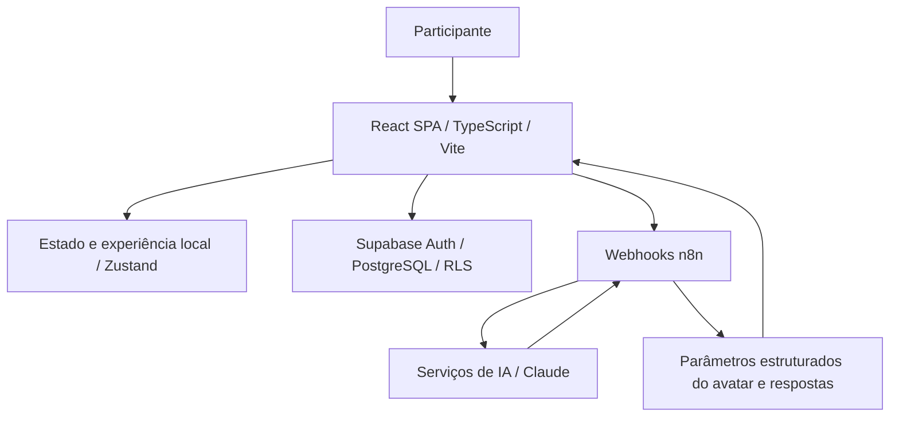

# FitLevel — Documento do sistema

[Voltar ao perfil](../README.md) · [Repositório](https://github.com/Joaaomottaa/fitlevel)

## Contexto e objetivo

Projeto colaborativo do Hackathon Órbita 2026 para incentivar hábitos por meio de check-ins, missões e evolução de avatar. A restrição de tempo favorece demonstração funcional e integração rápida. É uma aplicação de hábitos e gamificação; benefícios clínicos e redução de despesas de saúde não foram demonstrados.

## Base das informações

A arquitetura e funcionalidades abaixo se baseiam no README público do projeto. Não foi realizada auditoria completa de implementação, segurança ou eficácia. A participação individual de cada colaborador não é quantificada neste documento.

## Arquitetura

A interface concentra jornada, check-ins e gamificação. O estado local mantém a experiência de demonstração. Supabase fornece autenticação e dados sociais; n8n orquestra análise de avatar, chat, plano alimentar e feedback. O README descreve um motor SVG paramétrico: IA retorna parâmetros em vez de gerar uma nova imagem para cada mudança. O modo local não equivale a uma garantia de sincronização offline completa.

## Contexto da stack e alternativas

| Escolha | Benefício no contexto do hackathon | Contrapartida |
|---|---|---|
| React + TypeScript + Vite | Componentes, iteração rápida e verificação de tipos | SPA demanda atenção a bundle, estado e acessibilidade |
| Zustand | Gerenciamento leve do estado da jornada | Persistência e sincronização precisam de regras claras |
| Tailwind + Framer Motion | Consistência visual e animação do progresso | Excesso de animação pode afetar desempenho e acessibilidade |
| Supabase | Auth e banco reduzem infraestrutura inicial | RLS e limites de uso continuam responsabilidade da equipe |
| n8n + Claude | Workflows de IA substituíveis fora do navegador | Acrescenta serviço, latência, custo e monitoramento de execuções |
| Avatar SVG | Evolução visual sem gerar imagem a cada interação | Exige motor e parâmetros adequados; há limites de personalização |

Um backend próprio daria maior controle, com mais esforço inicial. Renderizar imagens por IA em cada etapa aumentaria custo variável e latência. A separação entre interface, estado, dados e workflows favorece evolução, mas não implica que SOLID ou POO tenham sido auditados neste projeto. Para produção, formalizar contratos dos webhooks, idempotência de check-ins e validação dos prêmios.

## Limites e evolução

Dados e fotos de saúde exigem consentimento, retenção definida e controle de acesso. O README informa fotos de evolução no dispositivo, enquanto certas funções de IA recebem imagens: são fluxos distintos. Respostas de IA devem ter limites de uso e revisão apropriados. PIX/escrow são simulados no MVP; não devem ser apresentados como pagamentos reais implantados. Medir retenção, conclusão de check-ins, falhas e custo por usuário ativo.

## Modelo econômico: CAPEX, OPEX e payback

Esta seção é uma análise para avaliação do projeto, não um demonstrativo financeiro realizado. Não foram fornecidos investimento, faturas, horas, receita ou economia mensurada. Os motivos econômicos abaixo são interpretações das escolhas técnicas, não registros históricos das decisões.

**CAPEX (visão gerencial):** investimento inicial em descoberta, desenvolvimento, testes, integrações, implantação e treinamento. Estimativa: `I = Σ(horas por atividade × custo/hora) + despesas iniciais`. A classificação contábil de desenvolvimento como ativo depende de critérios aplicáveis; horas de desenvolvimento não são automaticamente CAPEX contábil.

**OPEX:** hospedagem, banco, armazenamento, APIs, energia quando aplicável, monitoramento, suporte, manutenção e trabalho operacional recorrente. Estimativa mensal: `O = custos fixos + Σ(volume × custo unitário) + horas de operação × custo/hora`. Planos gratuitos não representam custo futuro garantido.

**Benefício líquido incremental mensal:** `B = margem de contribuição adicional + economias efetivamente realizadas − custos operacionais incrementais`. Não usar faturamento bruto como retorno, nem contar a mesma economia duas vezes. Tempo liberado é ganho de capacidade; só vira economia de caixa quando reduz desembolso ou gera margem adicional comprovada.

**Payback simples:** com benefício constante e positivo, `meses = I / B`. Com fluxos variáveis, localizar o primeiro mês em que `−I + Σ fluxo de caixa incremental mensal ≥ 0`. Se B for zero ou negativo, não há payback nesse cenário. O método simples ignora o valor do dinheiro no tempo; uma análise descontada precisa de taxa e horizonte definidos. Não há prazo de retorno comprovado para este projeto.

**Cenários:** comparar conservador, base e otimista variando adoção, volume, horas poupadas, margem, consumo de APIs e manutenção. Apurar também `TCO no horizonte = investimento inicial + operação acumulada + migração/desativação`, sem confundir TCO com retorno.

## Hipótese de retorno específica

CAPEX inclui experiência, lógica da jornada, avatar, integração e testes. OPEX inclui banco, hospedagem, workflows, chamadas e imagens enviadas à IA, suporte e manutenção. Avatar paramétrico pode reduzir geração repetida de imagens, mas o ganho precisa de comparação de custos.

O README propõe freemium; isso é hipótese comercial, não receita realizada. Para payback, medir usuários pagantes, margem por assinatura, churn, aquisição e custo de IA por usuário. Sem dados de monetização, o retorno demonstrável do hackathon é aprendizado e validação de produto, sem conversão automática em retorno financeiro.
