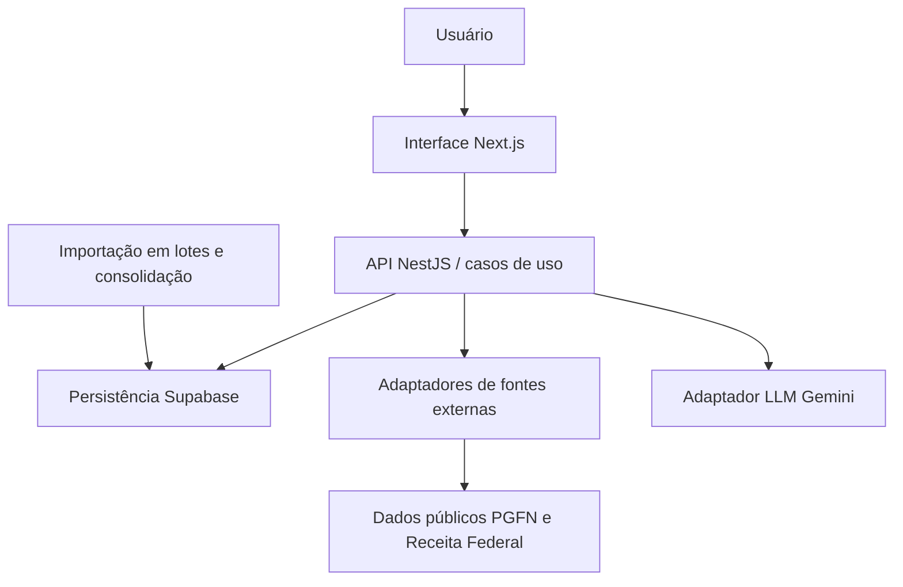

# Buscador Contábil PGFN - Documento do sistema

[Voltar ao perfil](../README.md)

## Contexto e objetivo

Projeto colaborativo para transformar dados públicos de dívida ativa e cadastros empresariais em informações úteis à prospecção. O objetivo é reduzir consulta manual, organizar prioridades e apoiar o trabalho comercial com fontes rastreáveis. Não constitui promessa de recuperação tributária ou conversão de vendas.

## Escopo e base das informações

Stack apresentada pelo autor: Next.js, NestJS, TypeScript, Supabase e IA com LLM Gemini. Modularização, SOLID, POO, alta coesão e baixo acoplamento foram informados pelo autor. A documentação consultada também descreve uma versão anterior centrada em Next.js e outro provedor de IA; portanto, o desenho abaixo representa a arquitetura declarada para o portfólio, sem afirmar que a migração de todas as integrações foi auditada no código.

## Arquitetura

Fluxo funcional: normalizar CNPJ, consultar registros consolidados, enriquecer informações cadastrais, apresentar ranking com filtros e paginação, solicitar análise comercial e registrar o resultado e as fontes. Importação e consolidação evitam reler bases completas em cada busca. O diagrama é lógico; não documenta servidores, redes ou contratos de implantação.

A organização modular separa consulta, importação, prospecção e integração com IA. Os casos de uso coordenam regras; interfaces delimitam acesso a fontes e persistência. POO e injeção de dependências permitem substituir adaptadores. Alta coesão concentra uma responsabilidade por módulo; baixo acoplamento evita dependências diretas entre interface, fornecedor de IA e fonte de dados. Essas são as diretrizes declaradas; uma certificação de aderência exigiria revisão do código e dos testes.

## Contexto da stack e alternativas

| Escolha | Adequação e benefício | Custo e contrapartida |
|---|---|---|
| Next.js + TypeScript | Interface web e contratos tipados; linguagem compartilhada | Exige disciplinar limites entre interface e servidor |
| NestJS | API modular, serviços e injeção de dependências | Mais configuração e implantação que concentrar tudo no Next.js |
| Supabase/PostgreSQL | Dados relacionais, autenticação e consultas estruturadas | Operação de índices, segurança, capacidade e custo do serviço continuam necessários |
| Gemini via adaptador | Análise textual sob demanda e substituição futura do provedor | Custo por consumo, latência, limites e respostas que precisam de validação |

Para um MVP pequeno, API no próprio Next.js reduz esforço inicial. Um backend NestJS separado pode compensar quando regras, integrações e múltiplos clientes justificam esse limite. Microserviços só devem ser considerados após demanda medida; adicionariam deploys, rede e observabilidade. A evolução deve preservar contratos e permitir troca gradual de adaptadores.

## Limites, operação e evolução

A qualidade depende da competência e atualização das bases. IA é apoio e não fonte de verdade: mostrar evidências, tratar falhas e manter revisão humana. Medir tempo por busca, duração de importação, latência, custo por análise, falhas de provedores e uso real. Antes de ampliar volume, avaliar índices, pré-agregação, processamento assíncrono e limites de consumo. O código empresarial e detalhes internos não são expostos neste documento.

## Modelo econômico: CAPEX, OPEX e payback

Esta seção é uma análise para avaliação do projeto, não um demonstrativo financeiro realizado. Não foram fornecidos investimento, faturas, horas, receita ou economia mensurada. Os motivos econômicos abaixo são interpretações das escolhas técnicas, não registros históricos das decisões.

**CAPEX (visão gerencial):** investimento inicial em descoberta, desenvolvimento, testes, integrações, implantação e treinamento. Estimativa: `I = Σ(horas por atividade × custo/hora) + despesas iniciais`. A classificação contábil de desenvolvimento como ativo depende de critérios aplicáveis; horas de desenvolvimento não são automaticamente CAPEX contábil.

**OPEX:** hospedagem, banco, armazenamento, APIs, energia quando aplicável, monitoramento, suporte, manutenção e trabalho operacional recorrente. Estimativa mensal: `O = custos fixos + Σ(volume × custo unitário) + horas de operação × custo/hora`. Planos gratuitos não representam custo futuro garantido.

**Benefício líquido incremental mensal:** `B = margem de contribuição adicional + economias efetivamente realizadas − custos operacionais incrementais`. Não usar faturamento bruto como retorno, nem contar a mesma economia duas vezes. Tempo liberado é ganho de capacidade; só vira economia de caixa quando reduz desembolso ou gera margem adicional comprovada.

**Payback simples:** com benefício constante e positivo, `meses = I / B`. Com fluxos variáveis, localizar o primeiro mês em que `−I + Σ fluxo de caixa incremental mensal ≥ 0`. Se B for zero ou negativo, não há payback nesse cenário. O método simples ignora o valor do dinheiro no tempo; uma análise descontada precisa de taxa e horizonte definidos. Não há prazo de retorno comprovado para este projeto.

**Cenários:** comparar conservador, base e otimista variando adoção, volume, horas poupadas, margem, consumo de APIs e manutenção. Apurar também `TCO no horizonte = investimento inicial + operação acumulada + migração/desativação`, sem confundir TCO com retorno.

## Hipótese de retorno específica

O investimento inicial concentra-se em importação, integração de dados, interface e validação. O OPEX cresce com armazenamento, consultas, atualizações de bases e análises de IA. Modularização acrescenta esforço inicial, mas pode reduzir custo de manutenção e troca de fornecedor; essa redução precisa ser medida.

Medir minutos por empresa antes/depois, empresas qualificadas, conversão atribuível e margem por contrato. A hipótese de retorno é maior capacidade de prospecção e menor retrabalho. Sem essas medições, não é possível declarar economia, percentual de ROI ou payback.
