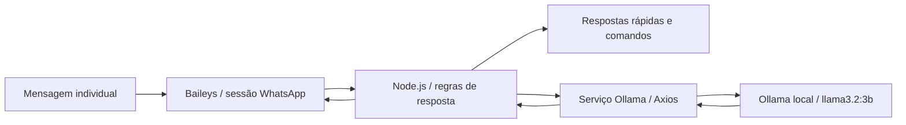

# WhatsApp AI Assistant — Documento do sistema

[Voltar ao perfil](../README.md) · [Repositório](https://github.com/nadson-engineer/whatsapp-ai-assistant)

## Contexto e objetivo

Bot experimental que conecta mensagens do WhatsApp a um modelo de linguagem local. Demonstra integração orientada a eventos e separação de acesso à IA em um serviço. O escopo é estudo e demonstração, não uma operação de atendimento com disponibilidade ou escala comprovadas.

## Arquitetura observada na documentação

O README descreve conexão por QR code e sessão persistida localmente. O ponto de entrada recebe eventos, ignora grupos e aplica regras de interação. O serviço separado chama o Ollama por HTTP e devolve a resposta. Comandos administrativos controlam ativação; respostas rápidas tratam interações simples. A estrutura documentada contém ponto de entrada, serviço Ollama e arquivos de dependências.

Não se deve descrever esse protótipo como microserviços ou alegar uma arquitetura corporativa completa. A separação da integração em serviço reduz acoplamento; interfaces adicionais, configuração externa e testes são evoluções possíveis, não implementação verificada.

## Contexto da stack e alternativas

| Escolha | Adequação | Contrapartida |
|---|---|---|
| Node.js | Fluxo assíncrono de mensagens e integração HTTP | Trabalho pesado de inferência deve permanecer fora do processo do bot |
| Baileys | Prototipação de conexão e eventos do WhatsApp | Dependência de compatibilidade e reconexão; não equivale à API oficial |
| Ollama + llama3.2:3b | Experimentação com inferência local e controle do runtime | Consome memória, processamento, energia e manutenção de máquina |
| Axios | Cliente HTTP simples para isolar chamada ao modelo | É necessário definir timeout, tratamento de erro e política de repetição |

Uma API de LLM hospedada reduziria necessidade de hardware, mas adicionaria cobrança por consumo e dependência externa. Uma integração oficial de mensageria exigiria outro desenho de autenticação, operação e custos. Antes de uso comercial, avaliar as condições de uso do canal e a adequação dessa alternativa. As alternativas não foram implantadas nem precificadas neste documento.

## Limites, segurança e evolução

A sessão local contém material de autenticação e deve permanecer fora do versionamento público. Inferência local não significa que toda comunicação seja offline: o canal de mensagens usa a rede. O README aponta necessidade de avaliar reconexão, configuração e tratamento de falhas. Para operação contínua, verificar controle de concorrência, timeout, retenção de mensagens, limites de resposta, observabilidade e encaminhamento humano. Medir latência, respostas úteis, indisponibilidade e custo por conversa resolvida.

## Modelo econômico: CAPEX, OPEX e payback

Esta seção é uma análise para avaliação do projeto, não um demonstrativo financeiro realizado. Não foram fornecidos investimento, faturas, horas, receita ou economia mensurada. Os motivos econômicos abaixo são interpretações das escolhas técnicas, não registros históricos das decisões.

**CAPEX (visão gerencial):** investimento inicial em descoberta, desenvolvimento, testes, integrações, implantação e treinamento. Estimativa: `I = Σ(horas por atividade × custo/hora) + despesas iniciais`. A classificação contábil de desenvolvimento como ativo depende de critérios aplicáveis; horas de desenvolvimento não são automaticamente CAPEX contábil.

**OPEX:** hospedagem, banco, armazenamento, APIs, energia quando aplicável, monitoramento, suporte, manutenção e trabalho operacional recorrente. Estimativa mensal: `O = custos fixos + Σ(volume × custo unitário) + horas de operação × custo/hora`. Planos gratuitos não representam custo futuro garantido.

**Benefício líquido incremental mensal:** `B = margem de contribuição adicional + economias efetivamente realizadas − custos operacionais incrementais`. Não usar faturamento bruto como retorno, nem contar a mesma economia duas vezes. Tempo liberado é ganho de capacidade; só vira economia de caixa quando reduz desembolso ou gera margem adicional comprovada.

**Payback simples:** com benefício constante e positivo, `meses = I / B`. Com fluxos variáveis, localizar o primeiro mês em que `−I + Σ fluxo de caixa incremental mensal ≥ 0`. Se B for zero ou negativo, não há payback nesse cenário. O método simples ignora o valor do dinheiro no tempo; uma análise descontada precisa de taxa e horizonte definidos. Não há prazo de retorno comprovado para este projeto.

**Cenários:** comparar conservador, base e otimista variando adoção, volume, horas poupadas, margem, consumo de APIs e manutenção. Apurar também `TCO no horizonte = investimento inicial + operação acumulada + migração/desativação`, sem confundir TCO com retorno.

## Hipótese de retorno específica

CAPEX inclui configuração do bot e, quando necessário, aquisição de hardware e preparação do modelo. Equipamento existente não tem desembolso inicial novo, mas continua com custo de uso e oportunidade. OPEX inclui energia, máquina, conectividade, manutenção e supervisão. Não pagar por token de API não torna a inferência gratuita.

Medir conversas resolvidas sem intervenção, tempo poupado efetivo, qualidade e retrabalho. Comparar custo total local com API hospedada no mesmo volume e padrão de qualidade. Sem dados de atendimento e operação, não é possível afirmar payback ou economia monetária.
